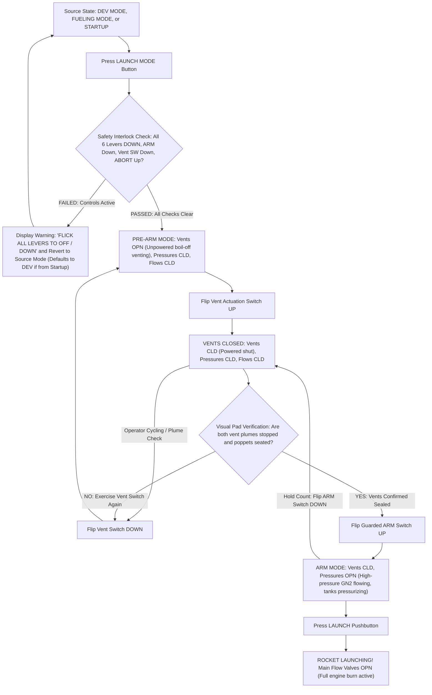
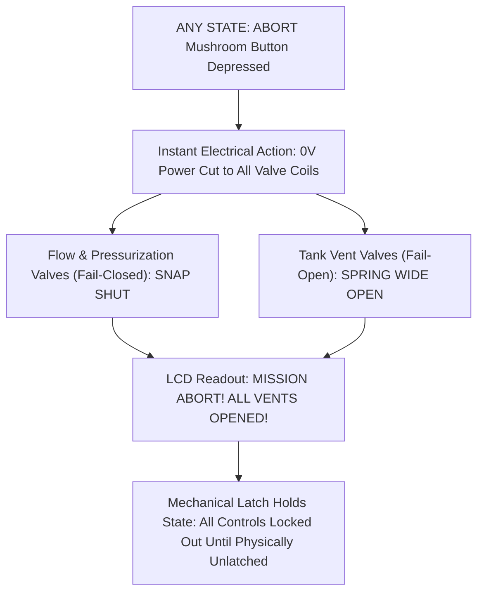

# Phoenix Rocket Ground Station: Operator & Flight Controller Manual

> [!IMPORTANT]
> **Operational Reference for Launch Conductors, Chief Engineers, and Fluids Leads**
> This manual details the physical console operation, operating modes, safety interlocks, and procedural rules of the **Phoenix Ground Control Box**. For repository setup and firmware compilation, refer to [README.md](README.md).

---

## 🚨 TL;DR: Critical Operator "DO NOT" Rules

Before touching any switch on the Phoenix Ground Control Box, all operators must memorize these core flight-line safety rules:

> [!WARNING]
> ### Golden Rules for Console Operators
> 1. **DO NOT assume Lever DOWN means Closed:** Cryogenic tank vents (`LNG-V` and `LOX-V`) are **Fail-Open (Normally Open)**. Setting a vent lever **DOWN / OFF cuts electrical power and leaves the valve physically OPEN (`OPN`)**. Setting it **UP / ON applies power to force the valve CLOSED (`CLD`)**. Always verify true physical valve state on the LCD screen!
> 2. **DO NOT arm pressurization before verifying vent closure:** In cryogenic conditions, vents may experience pneumatic sluggishness or seal icing. Flip the **Vent Switch UP first**, visually verify that both vent plumes have ceased (or pad camera confirms seated), and **only then flip the covered ARM switch UP**.
> 3. **DO NOT enter `DEV MODE` with levers flipped UP:** `DEV MODE` provides 100% direct, uninhibited manual control over valve coils. Any toggle lever left in the UP position will instantly energize that valve coil on the rocket pad.
> 4. **DO NOT leave vent valves powered shut during pad standby:** Powering vents closed (`UP / ON`) continuously draws battery power, risks solenoid thermal degradation, and traps cryogenic boil-off gas. Keep vent levers **DOWN / OFF** during standby to vent boil-off naturally.
> 5. **DO NOT expect the Ground Station to auto-abort on tank overpressure:** The firmware does **not** evaluate pressure transducers for automated aborts. Line safety relies exclusively on operator situational awareness, manual abort triggers, and physical mechanical relief valves on the plumbing.
> 6. **DO NOT power-cycle the console while propellant tanks are pressurized:** Cutting 12V/battery power to the console immediately drops all outputs to 0V. Tank vents will instantly spring wide open, causing violent depressurization.
> 7. **DO NOT attempt to force mode buttons while Armed, Vents Closed, or Aborted:** Mode switches (`DEV` / `FUEL`) are hard-locked while `VENTS_CLOSED` or `ARMED` (flip ARM and Vent switches DOWN first) and while `ABORT` is latched down (twist and pull the red mushroom button UP first).

---

## 1. System Overview & Physical Philosophy

The Ground Station is a standalone, hardwired control console. It communicates directly with the rocket’s valve controller boards over an umbilical Ethernet link.

### Physical Console Layout
* **6 Valve Control Levers:** Three-position toggle levers on the console faceplate controlling individual propellant and pressurization valves.
  * **Lever DOWN / OFF:** De-energized / No electrical power to the valve coil.
  * **Lever UP / ON:** Energized / Electrical power applied to the valve coil.
* **3 Mode Selection Buttons:** Momentary pushbuttons (`DEV MODE`, `FUELING MODE`, `LAUNCH MODE`) to transition between operational states.
* **Vent Actuation Toggle Switch:** Located immediately adjacent to the covered ARM switch (repurposed from the retired GN2 vent circuit). In Launch Mode, flipping this switch UP energizes and seals both cryogenic tank vents (`LNG-V` and `LOX-V`) to allow visual verification of pneumatic seating prior to tank pressurization.
* **Covered Safety ARM Toggle:** A guarded toggle switch protected by a spring-loaded safety cover, used to initiate tank pressurization (`LNG-P` and `LOX-P`) during countdown.
* **Momentary LAUNCH Pushbutton:** Triggers engine ignition and main propellant flow.
* **Mechanical ABORT Mushroom Button:** A prominent red latching emergency-stop button. Depressing it locks mechanically in the down position.
* **20x4 LCD Screen:** Displays current operating mode, live valve states (`OPN` vs `CLD`), countdown stages, and safety rejection messages.

---

## 2. Valve Types & Fail-Safe Mechanics

To operate the console safely, operators must understand the physical distinction between **Fail-Closed** and **Fail-Open** valves:

| Valve Name | Physical Type | Lever DOWN / OFF | Lever UP / ON |
| :--- | :--- | :--- | :--- |
| `LNG-P`, `LOX-P` | Fail-Closed (NC) | CLOSED (Unpowered) | OPEN (Powered) |
| `LNG-F`, `LOX-F` | Fail-Closed (NC) | CLOSED (Unpowered) | OPEN (Powered) |
| `LNG-V`, `LOX-V` | Fail-Open (NO) | **OPEN** (Unpowered) | **CLOSED** (Powered) |

### The Fail-Open Vent Philosophy
1. **Cryogenic Boil-Off Protection:** Liquid Methane (LNG) and Liquid Oxygen (LOX) boil off continuously on the pad. Because the tank vent valves (`LNG-V` and `LOX-V`) are **Fail-Open**, leaving their console levers in the default **DOWN / OFF** position cuts electrical power, causing the vent valves to spring physically open. Boil-off gas vents naturally to atmosphere without building pressure in the tanks.
2. **Zero Pad Power Draw:** The console does not draw battery power to keep vents open during standby. Solenoids stay cool and do not risk thermal degradation while waiting on the pad.
3. **Loss-of-Signal Safety:** If the ground station loses battery power or the umbilical cable is severed, power to all valves drops to zero immediately. The vents spring open to vent the tanks, and main propellant flows snap shut.

---

## 3. LCD Screen Interface

In **DEV** and **FUELING** modes, the LCD displays a two-column, 4-row status table showing the physical state of every valve:

```text
+--------------------+
|DEV MODE  LNG_P:CLD |
|LOX-P:CLD LNG-V:OPN |
|LNG-F:CLD LOX-V:OPN |
|LOX-F:CLD           |
+--------------------+
```

* **`OPN` (Open):** The valve is physically open and flowing fluid/gas.
* **`CLD` (Closed):** The valve is physically seated and holding pressure.
* The screen reports the **true physical state of the valve**, accounting for whether it is fail-closed or fail-open. An unpowered vent correctly displays `OPN`, while an unpowered flow valve displays `CLD`.

> [!WARNING]
> **Console Levers Correlate to Electrical Power, NOT Valve Direction:**
> Console toggle levers strictly control whether **electrical power** is applied to a valve's solenoid coil (`UP = POWERED`, `DOWN = UNPOWERED`).
> Because the vent valves (`LNG-V` and `LOX-V`) are **Fail-Open (Normally Open)**:
> * Setting a vent lever to **DOWN / OFF removes electrical power, leaving the valve physically OPEN (`OPN`)**.
> * Setting a vent lever to **UP / ON applies power to force the valve CLOSED (`CLD`)**.
> 
> For fail-closed valves (`LNG-P`, `LOX-P`, `LNG-F`, `LOX-F`), lever DOWN means unpowered/closed, and lever UP means powered/open.
> **Never assume Lever DOWN means closed for all valves! Always verify the LCD readout for the true physical valve state (`OPN` vs `CLD`).**

---

## 4. Operating Modes & Interlocks

The Ground Station enforces three distinct operating modes:

### Mode 1: Developer Mode (`DEV MODE`) — High Operational Risk
* **Purpose:** Pre-test checkouts, cold-flow testing, dry valve cycling, and leak checks before propellant loading.
* **Console Behavior:** Every valve toggle lever has **100% independent manual control**.
* **Safety Note:** Flipping any lever directly powers that valve coil on the rocket. Operators must maintain strict situational awareness of pad personnel and line pressure.

### Mode 2: Fueling Mode (`FUELING MODE`) — Medium Operational Risk
* **Purpose:** Propellant loading, tank chilling, and tank farm operations.
* **Console Behavior:**
  * **Main Flow Valves (`LNG-F`, `LOX-F`)** and **Pressurization Valves (`LNG-P`, `LOX-P`)** are **strictly locked closed** by software. Flipping their physical levers does nothing.
  * **Tank Vent Valves (`LNG-V`, `LOX-V`)** remain fully controllable via their individual console levers to manage tank chill and boil-off venting.

### Cryogenic Vent Exercising Procedure (Post-Fueling / Pre-Launch)
Under cryogenic conditions (liquid methane at ~111 K, liquid oxygen at ~90 K), atmospheric moisture condensation and extreme thermal contraction can cause pneumatic vent valve poppets or actuator seals to stick or bind. To prevent pneumatic actuation failure during terminal countdown:

> [!IMPORTANT]
> **Mandatory Vent Cycling Routine in `FUELING MODE`:**
> 1. Complete propellant loading and line chilling while in `FUELING MODE`.
> 2. Prior to transitioning the console to `LAUNCH MODE`, cycle the physical **`LNG-V`** and **`LOX-V`** toggle levers **UP (energize shut)** and **DOWN (spring open)** 3 to 5 times.
> 3. Verify on pad cameras or telemetry that both pneumatic actuators travel freely and seat completely without sticking.
> 4. Once clean pneumatic actuation is demonstrated, dynamic seal friction and mechanical clearing prevent freeze-binding for the duration of the countdown window.
> 5. Return both vent levers to **DOWN / OFF** (leaving vents physically open to vent boil-off naturally) before entering `LAUNCH MODE`.
> 
> *Why in `FUELING MODE`?* Operating in `FUELING MODE` is inherently safe because main flow and pressurization valves are hard-locked in software, eliminating any risk of uncommanded pressurant or propellant discharge during vent exercising.

### Mode 3: Launch Mode (`LAUNCH MODE`) — Low Manual Risk (Automated Safety)
* **Purpose:** Terminal countdown, tank pressurization, ignition, and flight execution.
* **Console Behavior:**
  * All 6 individual valve levers are **completely disconnected in software**.
  * Valve control is governed by an automated safety state machine driven exclusively by the **Vent Switch**, covered **ARM** switch, **LAUNCH** pushbutton, and **ABORT** button.

> [!WARNING]
> **Operator Responsibility for Vent Configuration on Mode Transitions:**
> The Ground Station firmware does **not** automatically configure or change vent valve positions when switching into `FUELING MODE` or `DEV MODE`.
> It is the **Ground Station Controller's direct responsibility** to verify that all physical valve levers—especially the tank vents (`LNG-V` and `LOX-V`)—are set to their intended operational positions (DOWN for open boil-off venting, UP for closed/sealed tanks) **before and immediately upon** switching modes.

---

## 5. Launch Sequence: The "Happy Trail" Procedure



### Step 1: Pre-Launch Readiness (Console Baseline)
Before entering Launch Mode, the operator console **must** be configured as follows:
* All 6 Valve Levers: **DOWN / OFF**
  * Flow & Pressure valves are unpowered (closed).
  * Vent valves are unpowered (open, venting boil-off).
* Vent Actuation Switch: **DOWN / OFF**
* ARM Toggle Switch: **DOWN / DISARMED** (Safety cover closed).
* ABORT Button: **UP / UNLATCHED** (Released).

### Step 2: Entering Launch Mode (`PRE-ARM`)
1. Press the **`LAUNCH MODE`** button.
2. The screen displays `"SWITCHING STATE / WAIT..."` for 2 seconds while console switches stabilize.
3. The safety check verifies all levers and arming switches are DOWN.
4. The LCD enters **`PRE-ARM MODE`**:
   ```text
   +--------------------+
   |  LAUNCH SEQUENCE   |
   |    PRE ARM MODE    |
   |V:OPN  P:CLD  F:CLD |
   +--------------------+
   ```
   * **Vents (`V`):** `OPN` (Zero power, boil-off venting freely).
   * **Pressures (`P`):** `CLD` (Zero power, GN2 shut off).
   * **Flows (`F`):** `CLD` (Zero power, propellant lines shut).

### Step 3: Vent Pre-Actuation & Visual Verification (`VENTS CLOSED`)
To prevent blowing high-pressure GN2 pressurant out the vents if cryo valve poppets lag or bind:
1. Flip the **Vent Actuation Switch UP**.
2. Electrical power is applied to `LNG-V` and `LOX-V` to seat them closed. Pressure and flow valves remain unpowered closed.
3. The LCD enters **`VENTS CLOSED`**:
   ```text
   +--------------------+
   |  LAUNCH SEQUENCE   |
   |    VENTS CLOSED    |
   |V:CLD  P:CLD  F:CLD |
   +--------------------+
   ```
4. **Visual Verification Gate:** The Launch Conductor and Fluids Lead visually verify on pad cameras that cryogenic vent plumes have completely ceased, confirming mechanical seating.
   * *If a vent hangs or lags:* The operator can toggle the Vent Switch DOWN and UP repeatedly to seat the valve.

### Step 4: Arming & Tank Pressurization (`ARM MODE`)
1. Only after both vents are visually confirmed sealed, flip the guarded **`ARM`** toggle switch **UP**.
2. High-pressure GN2 valves (`LNG-P` and `LOX-P`) open to bring propellant tanks up to flight pressure.
3. The LCD updates to **`ARM MODE`**:
   ```text
   +--------------------+
   |  LAUNCH SEQUENCE   |
   |      ARM MODE      |
   |V:CLD  P:OPN  F:CLD |
   +--------------------+
   ```
4. **Safety Interlock:** The firmware will not open pressure valves if the Vent Switch is DOWN.

### Step 5: Disarming (If Holding Count)
If a hold is called while in `ARM MODE`:
1. Flip the guarded **`ARM`** switch back **DOWN**.
2. Pressure valves instantly close (`LNG-P` and `LOX-P` cut to 0V).
3. If the Vent Switch remains UP, the console safely returns to **`VENTS CLOSED`** (`V:CLD P:CLD F:CLD`), holding tank pressure without adding GN2.
4. If full tank depressurization is ordered, flip the **Vent Switch DOWN**; vents instantly spring open and the console returns to **`PRE-ARM MODE`** (`V:OPN P:CLD F:CLD`).
5. *Automatic Cutoff:* If the Vent Switch is accidentally flipped DOWN while `ARM` is UP, the firmware instantly cuts pressurization and drops to `PRE-ARM` to prevent pressurizing through open vents.

### Step 6: Launch / Ignition Trigger
1. With the rocket in `ARM MODE` and all flight go-criteria satisfied, press the momentary **`LAUNCH`** pushbutton.
2. The LCD updates to:
   ```text
   +--------------------+
   |  LAUNCH SEQUENCE   |
   | ROCKET LAUNCHING!  |
   |V:CLD  P:OPN  F:OPN |
   |Ad Astra Per Aspera!|
   +--------------------+
   ```
   * Main flow valves (`LNG-F`, `LOX-F`) open.
   * Pressure valves stay open; vent valves stay powered shut.
   * The rocket has transitioned to active burn.

---

## 6. Emergency Abort Operations

The red **ABORT** button is the highest-priority control on the console. It can be triggered at any time during `PRE-ARM`, `ARMED`, `LAUNCH`, or terminal countdown.



### What Happens When Abort is Depressed:
1. **Instant Electrical Power Drop:** Electrical power to every valve coil on the rocket drops to **0V instantaneously**.
2. **Valve Reaction:**
   * Main flow valves (`LNG-F`, `LOX-F`) and pressure valves (`LNG-P`, `LOX-P`) snap **CLOSED**.
   * Vent valves (`LNG-V`, `LOX-V`) lose holding power and **SPRING WIDE OPEN**, rapidly venting all tank pressure to atmosphere.
3. **Console LCD Readout:**
   ```text
   +--------------------+
   |  LAUNCH SEQUENCE   |
   |   MISSION ABORT!   |
   |V:OPN  P:CLD  F:CLD |
   | ALL VENTS OPENED!  |
   +--------------------+
   ```
4. **Hard Latch:** The console enters a locked abort state. Toggling the ARM switch or pressing the LAUNCH button produces zero response.

### Abort Recovery Procedure
To clear an abort after the pad is declared safe:
1. **Verify All Console Levers DOWN / OFF:** Physically inspect the console and ensure **every single toggle lever is in the DOWN / OFF position**.
2. **Unlatch the ABORT Button:** Physically twist or pull the red mushroom button **UP**. (The console will refuse to switch modes while the button remains mechanically held down).
3. **Select Safe Mode:** Press the **`DEV MODE`** (or **`FUELING MODE`**) button.
4. The console clears the abort latch, runs the 2-second switch stabilization routine, and displays the manual valve table in DEV mode with all valves unpowered.

#### The Abort Exit Interlock (`ABORT EXIT BLOCKED`)
To prevent catastrophic valve actuation during pad safing, firmware enforces a hard hardware check on all 6 toggle levers before allowing exit from `MISSION ABORT`.

If an operator unlatches the ABORT button and presses `DEV MODE` or `FUELING MODE` while **any valve lever is left UP / ON**:
1. The mode transition is **immediately rejected**.
2. The console LCD flashes the rejection screen for 2 seconds:
   ```text
   +--------------------+
   | ABORT EXIT BLOCKED |
   |  FLICK ALL LEVERS  |
   |   TO OFF / DOWN    |
   +--------------------+
   ```
3. The LCD automatically restores the `MISSION ABORT!` status screen.
4. **Zero electrical power is applied to any valve coil**; the console remains safely locked at 0V.
5. Once all levers are physically returned to **DOWN / OFF**, pressing `DEV MODE` or `FUELING MODE` cleanly exits the abort.

> [!CAUTION]
> **Maintain Operator Vigilance During Abort Recovery:**
> While firmware enforces an active hardware interlock that blocks abort exit if levers are UP, **operators must never rely on software as their sole defense against pad hazards**.
> In `DEV MODE`, all valve levers are 100% live in real time. If an operator enters DEV mode and subsequently flips a switch UP without checking line status, that valve energizes immediately.
> **Standard Operating Procedure:** Always maintain strict checklist discipline, verify lines are depressurized and pad areas are cleared, and confirm all switches are DOWN / OFF before clearing an emergency abort.

---

## 7. Safety Interlocks: What the Console Protects vs. Does NOT Protect

### What the Ground Station PROTECTS (Hard Interlocks):
* **Launch Entry Interlock:** Entering Launch Mode is **blocked** if any valve lever on the console is left flipped UP. If an operator attempts to enter Launch Mode with a lever UP, the console rejects entry and displays:
  ```text
   LAUNCH MODE FAILED 
    FLICK ALL LEVERS  
      TO OFF / DOWN   
  ```
* **Abort Exit Interlock:** Exiting `MISSION ABORT` into `DEV MODE` or `FUELING MODE` is **hard-blocked** if any valve toggle lever is left UP. If an operator attempts to switch modes with a lever UP, the console rejects the transition, displays:
  ```text
   ABORT EXIT BLOCKED 
    FLICK ALL LEVERS  
     TO OFF / DOWN    
  ```
  and restores the locked `MISSION ABORT!` screen, maintaining 0V to all valve coils.
* **Arm / Abort Entry Interlock:** Entering Launch Mode is **blocked** if the ARM switch is UP, the Vent Switch is UP, or the ABORT button is down.
* **In-Flight Mode Lockout:** Once the rocket is in `VENTS_CLOSED`, `ARM MODE`, or `LAUNCH`, **all mode buttons (DEV / FUEL) are completely locked out**. An operator cannot accidentally switch modes or dump pressure while armed. The operator must explicitly disarm (flip ARM and Vent switches down) or hit ABORT.
* **E-Stop Reset Lockout:** The console will not allow mode transitions out of an abort until the ABORT button is physically pulled back UP.
* **Pressurant Conservation (Decoupled 2-Stage Arming):** Requires the operator to flip the Vent Switch to seal vents (`VENTS CLOSED`) and visually verify seating on pad cameras before the covered ARM switch will command GN2 pressure valves open. Opening pressure valves is hard-locked in software if the Vent Switch is DOWN.
* **Zero Power Spikes:** FSM state transitions are protected so that failed launch attempts do not power-cycle or glitch valve coils.

---

### What the Ground Station DOES NOT Protect (Fluids & Crew Responsibilities):
* **Automatic Overpressure Abort:** The ground station does **not** automatically trigger an abort if tank pressure rises too high. Operators and Fluids engineers must monitor pressure gauges / telemetry; line safety relies on physical spring-loaded mechanical relief valves on the plumbing.
* **Manual DEV Mode Misinputs:** In `DEV MODE`, all valve levers are live. The console will **not** stop an operator from opening a main propellant flow valve while tanks are pressurized if DEV mode is active.
* **Manual Valve Commands Post-Recovery:** While the console prevents exiting Abort with levers UP, once DEV mode is entered, all levers are live. The console will not prevent an operator from manually toggling a valve ON after entering DEV mode.
* **Pneumatic / Bottle Pressure Monitoring:** The console cannot detect whether GN2 supply bottles are depleted or if manual hand valves on the pad are closed.
* **Pad Power Faults:** If external 12V/24V solenoid power supplies fail at the pad, the console will report commanded states, but valves will physically revert to their unpowered states (vents open, flows closed).
