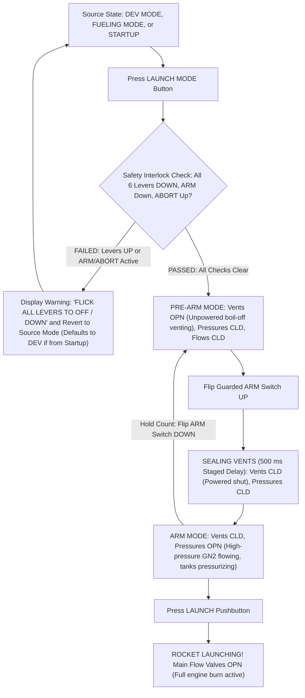
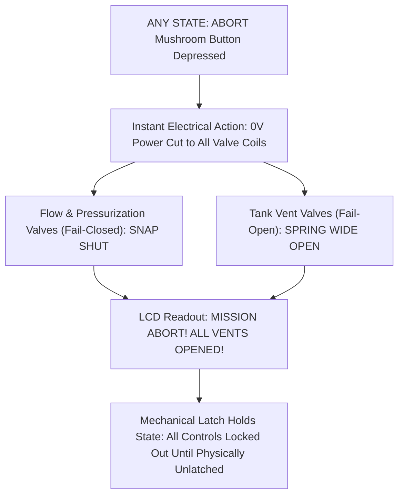

# Phoenix Rocket Ground Station: Operator & Flight Controller Manual

> [!IMPORTANT]
> **Operational Reference for Launch Conductors, Chief Engineers, and Fluids Leads**
> This manual details the physical console operation, operating modes, safety interlocks, and procedural rules of the **Phoenix Ground Control Box**. For repository setup and firmware compilation, refer to [README.md](README.md).

---

## 1. System Overview & Physical Philosophy

The Ground Station is a standalone, hardwired control console. It communicates directly with the rocket’s valve controller boards over an umbilical Ethernet link.

### Physical Console Layout
* **6 Valve Control Levers:** Three-position toggle levers on the console faceplate controlling individual propellant and pressurization valves.
  * **Lever DOWN / OFF:** De-energized / No electrical power to the valve coil.
  * **Lever UP / ON:** Energized / Electrical power applied to the valve coil.
* **3 Mode Selection Buttons:** Momentary pushbuttons (`DEV MODE`, `FUELING MODE`, `LAUNCH MODE`) to transition between operational states.
* **Covered Safety ARM Toggle:** A guarded toggle switch protected by a spring-loaded safety cover, used to initiate pressurization during countdown.
* **Momentary LAUNCH Pushbutton:** Triggers engine ignition and main propellant flow.
* **Mechanical ABORT Mushroom Button:** A prominent red latching emergency-stop button. Depressing it locks mechanically in the down position.
* **20x4 LCD Screen:** Displays current operating mode, live valve states (`OPN` vs `CLD`), countdown stages, and safety rejection messages.

> [!NOTE]
> **Unlabeled Toggle Lever on Console Faceplate:**
> There is a 7th physical toggle switch on the console faceplate that is unlabeled and unwired (a remnant of a removed pneumatic line). Operators must ignore this switch; it is completely disconnected and has no electrical connection to the rocket or ground station firmware.

---

## 2. Valve Types & Fail-Safe Mechanics

To operate the console safely, operators must understand the physical distinction between **Fail-Closed** and **Fail-Open** valves:

| Valve Name | Physical Type | Lever DOWN / OFF | Lever UP / ON |
| :--- | :--- | :--- | :--- |
| `LNG-P`, `LOX-P` | Fail-Closed (NC) | CLOSED (Unpowered) | OPEN (Powered) |
| `LNG-F`, `LOX-F` | Fail-Closed (NC) | CLOSED (Unpowered) | OPEN (Powered) |
| `LNG-V`, `LOX-V` | Fail-Open (NO) | **OPEN** (Unpowered) | **CLOSED** (Powered) |

### The Fail-Open Vent Philosophy
1. **Cryogenic Boil-Off Protection:** Liquid Methane (LNG) and Liquid Oxygen (LOX) boil off continuously on the pad. Because the tank vent valves (`LNG-V` and `LOX-V`) are **Fail-Open**, leaving their console levers in the default **DOWN / OFF** position cuts electrical power, causing the vent valves to spring physically open. Boil-off gas vents naturally to atmosphere without building pressure in the tanks.
2. **Zero Pad Power Draw:** The console does not draw battery power to keep vents open during standby. Solenoids stay cool and do not risk thermal degradation while waiting on the pad.
3. **Loss-of-Signal Safety:** If the ground station loses battery power or the umbilical cable is severed, power to all valves drops to zero immediately. The vents spring open to vent the tanks, and main propellant flows snap shut.

---

## 3. LCD Screen Interface

In **DEV** and **FUELING** modes, the LCD displays a two-column, 4-row status table showing the physical state of every valve:

```text
+--------------------+
|DEV MODE  LNG_P:CLD |
|LOX-P:CLD LNG-V:OPN |
|LNG-F:CLD LOX-V:OPN |
|LOX-F:CLD           |
+--------------------+
```

* **`OPN` (Open):** The valve is physically open and flowing fluid/gas.
* **`CLD` (Closed):** The valve is physically seated and holding pressure.
* The screen reports the **true physical state of the valve**, accounting for whether it is fail-closed or fail-open. An unpowered vent correctly displays `OPN`, while an unpowered flow valve displays `CLD`.

> [!WARNING]
> **Console Levers Correlate to Electrical Power, NOT Valve Direction:**
> Console toggle levers strictly control whether **electrical power** is applied to a valve's solenoid coil (`UP = POWERED`, `DOWN = UNPOWERED`).
> Because the vent valves (`LNG-V` and `LOX-V`) are **Fail-Open (Normally Open)**:
> * Setting a vent lever to **DOWN / OFF removes electrical power, leaving the valve physically OPEN (`OPN`)**.
> * Setting a vent lever to **UP / ON applies power to force the valve CLOSED (`CLD`)**.
> 
> For fail-closed valves (`LNG-P`, `LOX-P`, `LNG-F`, `LOX-F`), lever DOWN means unpowered/closed, and lever UP means powered/open.
> **Never assume Lever DOWN means closed for all valves! Always verify the LCD readout for the true physical valve state (`OPN` vs `CLD`).**

---

## 4. Operating Modes & Interlocks

The Ground Station enforces three distinct operating modes:

### Mode 1: Developer Mode (`DEV MODE`) — High Operational Risk
* **Purpose:** Pre-test checkouts, cold-flow testing, dry valve cycling, and leak checks before propellant loading.
* **Console Behavior:** Every valve toggle lever has **100% independent manual control**.
* **Safety Note:** Flipping any lever directly powers that valve coil on the rocket. Operators must maintain strict situational awareness of pad personnel and line pressure.

### Mode 2: Fueling Mode (`FUELING MODE`) — Medium Operational Risk
* **Purpose:** Propellant loading, tank chilling, and tank farm operations.
* **Console Behavior:**
  * **Main Flow Valves (`LNG-F`, `LOX-F`)** and **Pressurization Valves (`LNG-P`, `LOX-P`)** are **strictly locked closed** by software. Flipping their physical levers does nothing.
  * **Tank Vent Valves (`LNG-V`, `LOX-V`)** remain fully controllable via their individual console levers to manage tank chill and boil-off venting.

### Mode 3: Launch Mode (`LAUNCH MODE`) — Low Manual Risk (Automated Safety)
* **Purpose:** Terminal countdown, tank pressurization, ignition, and flight execution.
* **Console Behavior:**
  * All 6 individual valve levers are **completely disconnected in software**.
  * Valve control is governed by an automated safety state machine driven exclusively by the **ARM** switch, **LAUNCH** button, and **ABORT** button.

> [!WARNING]
> **Operator Responsibility for Vent Configuration on Mode Transitions:**
> The Ground Station firmware does **not** automatically configure or change vent valve positions when switching into `FUELING MODE` or `DEV MODE`.
> It is the **Ground Station Controller's direct responsibility** to verify that all physical valve levers—especially the tank vents (`LNG-V` and `LOX-V`)—are set to their intended operational positions (DOWN for open boil-off venting, UP for closed/sealed tanks) **before and immediately upon** switching modes.

---

## 5. Launch Sequence: The "Happy Trail" Procedure



### Step 1: Pre-Launch Readiness (Console Baseline)
Before entering Launch Mode, the operator console **must** be configured as follows:
* All 6 Valve Levers: **DOWN / OFF**
  * Flow & Pressure valves are unpowered (closed).
  * Vent valves are unpowered (open, venting boil-off).
* ARM Toggle Switch: **DOWN / DISARMED** (Safety cover closed).
* ABORT Button: **UP / UNLATCHED** (Released).

### Step 2: Entering Launch Mode (`PRE-ARM`)
1. Press the **`LAUNCH MODE`** button.
2. The screen displays `"SWITCHING STATE / WAIT..."` for 2 seconds while console switches stabilize.
3. The safety check verifies all levers are DOWN.
4. The LCD enters **`PRE-ARM MODE`**:
   ```text
   +--------------------+
   |  LAUNCH SEQUENCE   |
   |    PRE ARM MODE    |
   |V:OPN  P:CLD  F:CLD |
   +--------------------+
   ```
   * **Vents (`V`):** `OPN` (Zero power, boil-off venting freely).
   * **Pressures (`P`):** `CLD` (Zero power, GN2 shut off).
   * **Flows (`F`):** `CLD` (Zero power, propellant lines shut).

### Step 3: Arming & Staged Pressurization
1. Flip the red covered **`ARM`** toggle switch **UP**.
2. **Phase 1 — Vent Sealing (500 ms delay):**
   ```text
   +--------------------+
   |  LAUNCH SEQUENCE   |
   |   SEALING VENTS    |
   |V:CLD  P:CLD  F:CLD |
   +--------------------+
   ```
   * Power is immediately applied to `LNG-V` and `LOX-V` to seat them closed.
   * Pressure valves remain closed.
   * *Purpose:* Prevents blowing high-pressure GN2 pressurant out the open vent lines while the vent valve poppets travel to their closed seats.
3. **Phase 2 — Tank Pressurization (`ARM MODE`):**
   ```text
   +--------------------+
   |  LAUNCH SEQUENCE   |
   |      ARM MODE      |
   |V:CLD  P:OPN  F:CLD |
   +--------------------+
   ```
   * 500 ms after vents seal, `LNG-P` and `LOX-P` open.
   * High-pressure GN2 enters the fuel and oxidizer tanks to bring them up to flight pressure.

### Step 4: Disarming (If Holding Count)
If the countdown is held while in `ARM MODE`:
1. Flip the **`ARM`** switch back **DOWN**.
2. Pressure valves instantly close, vent valves instantly unpower and spring open.
3. The console safely returns to **`PRE-ARM MODE`** (`V:OPN P:CLD F:CLD`), depressurizing the tanks.

### Step 5: Launch / Ignition Trigger
1. With the rocket in `ARM MODE`, press the momentary **`LAUNCH`** pushbutton.
2. The LCD updates to:
   ```text
   +--------------------+
   |  LAUNCH SEQUENCE   |
   | ROCKET LAUNCHING!  |
   |V:CLD  P:OPN  F:OPN |
   |Ad Astra Per Aspera!|
   +--------------------+
   ```
   * Main flow valves (`LNG-F`, `LOX-F`) open.
   * Pressure valves stay open; vent valves stay powered shut.
   * The rocket has transitioned to active burn.

---

## 6. Emergency Abort Operations

The red **ABORT** button is the highest-priority control on the console. It can be triggered at any time during `PRE-ARM`, `ARMED`, `LAUNCH`, or terminal countdown.



### What Happens When Abort is Depressed:
1. **Instant Electrical Power Drop:** Electrical power to every valve coil on the rocket drops to **0V instantaneously**.
2. **Valve Reaction:**
   * Main flow valves (`LNG-F`, `LOX-F`) and pressure valves (`LNG-P`, `LOX-P`) snap **CLOSED**.
   * Vent valves (`LNG-V`, `LOX-V`) lose holding power and **SPRING WIDE OPEN**, rapidly venting all tank pressure to atmosphere.
3. **Console LCD Readout:**
   ```text
   +--------------------+
   |  LAUNCH SEQUENCE   |
   |   MISSION ABORT!   |
   |V:OPN  P:CLD  F:CLD |
   | ALL VENTS OPENED!  |
   +--------------------+
   ```
4. **Hard Latch:** The console enters a locked abort state. Toggling the ARM switch or pressing the LAUNCH button produces zero response.

### Abort Recovery Procedure
To clear an abort after the pad is declared safe:
1. **Verify All Console Levers DOWN / OFF:** Physically inspect the console and ensure **every single toggle lever is in the DOWN / OFF position**.
2. **Unlatch the ABORT Button:** Physically twist or pull the red mushroom button **UP**. (The console will refuse to switch modes while the button remains mechanically held down).
3. **Select Safe Mode:** Press the **`DEV MODE`** button.
4. The console clears the abort latch and displays the manual valve table in DEV mode.

> [!CAUTION]
> **DANGER: Verify All Levers DOWN Before Exiting Abort Mode!**
> While the console is latched in `MISSION ABORT`, electrical power to all valves is locked at 0V regardless of lever positions. However, **`DEV MODE` reads physical lever states continuously in real time**.
> If any valve toggle levers were accidentally bumped, switched, or left **UP / ON** while in Abort mode, those switches have no effect *while abort remains active*. **However, the moment you unlatch the ABORT button and press `DEV MODE`, the console immediately applies electrical power to those valve coils!**
> For example, if a main propellant flow or pressurization lever is left UP, that valve will snap wide open on the pad the instant you enter DEV mode.
> **Standard Operating Procedure:** Always visually verify that all 6 valve control levers are physically DOWN / OFF before unlatching the ABORT button and entering DEV mode.

---

## 7. Safety Interlocks: What the Console Protects vs. Does NOT Protect

### What the Ground Station PROTECTS (Hard Interlocks):
* **Launch Entry Interlock:** Entering Launch Mode is **blocked** if any valve lever on the console is left flipped UP. If an operator attempts to enter Launch Mode with a lever UP, the console rejects entry and displays:
  ```text
   LAUNCH MODE FAILED 
    FLICK ALL LEVERS  
      TO OFF / DOWN   
  ```
* **Arm / Abort Entry Interlock:** Entering Launch Mode is **blocked** if the ARM switch is UP or the ABORT button is down.
* **In-Flight Mode Lockout:** Once the rocket is in `ARM MODE` or `LAUNCH`, **all mode buttons (DEV / FUEL) are completely locked out**. An operator cannot accidentally switch modes or dump pressure while armed. The operator must explicitly disarm (flip ARM down) or hit ABORT.
* **E-Stop Reset Lockout:** The console will not allow mode transitions out of an abort until the ABORT button is physically pulled back UP.
* **Pressurant Conservation (Staged Arming):** Enforces a 500 ms delay to seat vent valves before opening GN2 pressure valves.
* **Zero Power Spikes:** FSM state transitions are protected so that failed launch attempts do not power-cycle or glitch valve coils.

---

### What the Ground Station DOES NOT Protect (Fluids & Crew Responsibilities):
* **Automatic Overpressure Abort:** The ground station does **not** automatically trigger an abort if tank pressure rises too high. Operators and Fluids engineers must monitor pressure gauges / telemetry; line safety relies on physical spring-loaded mechanical relief valves on the plumbing.
* **Manual DEV Mode Misinputs:** In `DEV MODE`, all valve levers are live. The console will **not** stop an operator from opening a main propellant flow valve while tanks are pressurized if DEV mode is active.
* **Pre-Existing Lever States on Abort Exit:** In `DEV MODE`, all valve coils immediately take the state of their physical faceplate levers. If an operator exits `MISSION ABORT` into `DEV MODE` while a toggle lever is left UP, the console will instantly apply power to that valve.
* **Pneumatic / Bottle Pressure Monitoring:** The console cannot detect whether GN2 supply bottles are depleted or if manual hand valves on the pad are closed.
* **Pad Power Faults:** If external 12V/24V solenoid power supplies fail at the pad, the console will report commanded states, but valves will physically revert to their unpowered states (vents open, flows closed).
