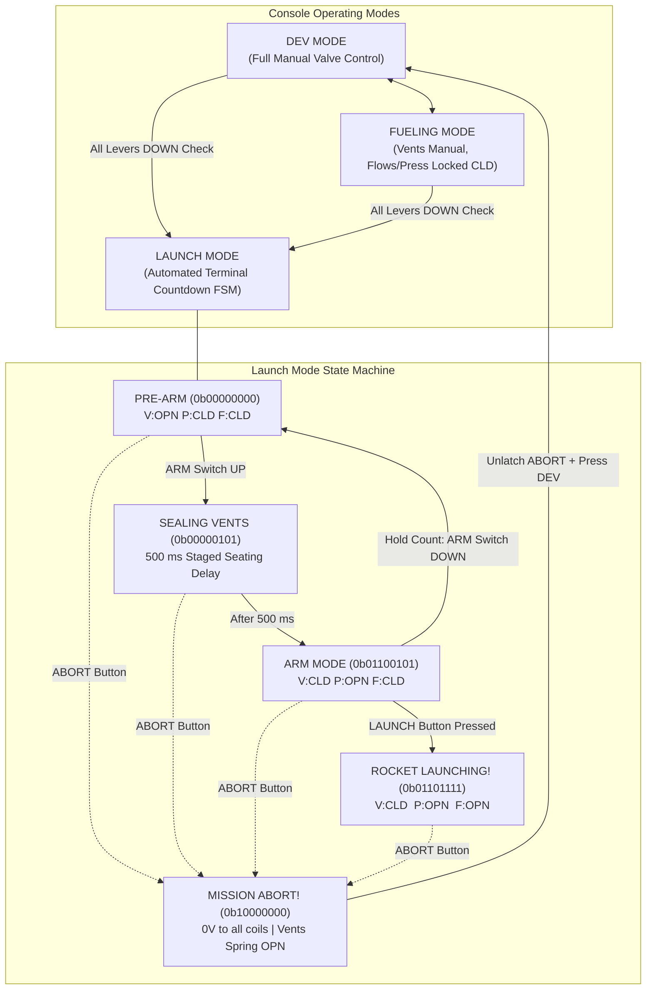

# Phoenix Ground Station (`phoenix-gs`)

Standalone ground control console firmware powered by an Arduino Mega 2560 and a W5500 Ethernet module. Communicates over umbilical Ethernet to command rocket valve boards and read telemetry with hardware and software safety interlocks.

> [!TIP]
> For Launch Conductors, Chief Engineers, and Fluids Leads, refer to the full **[Operator & Flight Controller Manual](OPERATOR_MANUAL.md)** for operational rules, bench-check procedures, and console interlocks.

---

## 1. System Overview & Valve Philosophy

The ground station manages 6 active propellant and pressurization valves. Tank vent valves (`LNG-V` and `LOX-V`) are **Fail-Open (Normally Open)**, while pressurization and flow valves are **Fail-Closed (Normally Closed)**.

| Valve Identifier | Function | Valve Type | Console Lever DOWN / OFF | Console Lever UP / ON |
| :--- | :--- | :--- | :--- | :--- |
| `LNG-P` | LNG Tank Pressurization (GN2) | Fail-Closed (NC) | CLOSED (0V unpowered) | OPEN (Powered) |
| `LOX-P` | LOX Tank Pressurization (GN2) | Fail-Closed (NC) | CLOSED (0V unpowered) | OPEN (Powered) |
| `LNG-F` | LNG Main Engine Flow | Fail-Closed (NC) | CLOSED (0V unpowered) | OPEN (Powered) |
| `LOX-F` | LOX Main Engine Flow | Fail-Closed (NC) | CLOSED (0V unpowered) | OPEN (Powered) |
| `LNG-V` | LNG Cryogenic Tank Vent | **Fail-Open (NO)** | **OPEN** (0V unpowered) | **CLOSED** (Powered) |
| `LOX-V` | LOX Cryogenic Tank Vent | **Fail-Open (NO)** | **OPEN** (0V unpowered) | **CLOSED** (Powered) |

> [!NOTE]
> * `GN2-V` has been removed from the plumbing architecture; GN2 is split between `LNG-P` and `LOX-P`.
> * The console faceplate contains a 7th toggle lever that is unlabeled and unwired; operators must ignore it.
> * **Cryogenic Boil-Off & Pad Power:** Because tank vents are Fail-Open, keeping their levers DOWN (unpowered) leaves vents naturally open to vent boil-off without drawing battery power or heating solenoid coils.
> * **Loss of Signal (Fail-Safe):** In any power loss or cable disconnect, all coils drop to 0V: flows snap shut and vents spring wide open.

---

## 2. Valve Masks & State Encoding

Valve commands are packed into an 8-bit state byte transmitted over Ethernet raw MAC frames (`gs/constants.h`):

### 8-Bit Valve Coil Masks
```cpp
const uint8_t LNG_PRES_MASK = 0b01000000; // Bit 6: Fail-Closed
const uint8_t LOX_PRES_MASK = 0b00100000; // Bit 5: Fail-Closed
const uint8_t LNG_FLOW_MASK = 0b00001000; // Bit 3: Fail-Closed
const uint8_t LNG_VENT_MASK = 0b00000100; // Bit 2: Fail-Open
const uint8_t LOX_FLOW_MASK = 0b00000010; // Bit 1: Fail-Closed
const uint8_t LOX_VENT_MASK = 0b00000001; // Bit 0: Fail-Open
const uint8_t NULL_MASK     = 0b00000000;

// Fail-Open Mask (vent coil power required to seal)
const uint8_t FAIL_OPEN_MASK = LNG_VENT_MASK | LOX_VENT_MASK; // 0b00000101
```

### Launch Sequence Encoding
```cpp
const uint8_t PRE_ARM      = NULL_MASK;                                      // 0b00000000 (Vents unpowered OPN, flows/pressures unpowered CLD)
const uint8_t VENTS_CLOSED = FAIL_OPEN_MASK;                                 // 0b00000101 (Vent coils energized shut; 500 ms staged arming delay)
const uint8_t ARMED        = VENTS_CLOSED | (LNG_PRES_MASK | LOX_PRES_MASK); // 0b01100101 (Vents powered shut, pressures powered open)
const uint8_t LAUNCH       = ARMED | LNG_FLOW_MASK | LOX_FLOW_MASK;          // 0b01101111 (Vents shut, pressures open, main flows open)
const uint8_t ABORT        = 0b10000000;                                     // Bit 7 non-valve mask (0V to all valve coils; vents spring open)
```

---

## 3. Finite State Machine (FSM) & Operating Modes



### Mode 1: Developer Mode (`DEV MODE`) — High Risk
* Intended for pre-test dry valve cycling, cold flows, and line leak checks.
* Every console toggle lever directly controls electrical power to its corresponding valve coil.
* **Caution:** Toggling levers directly energizes or de-energizes valves on the pad.

### Mode 2: Fueling Mode (`FUELING MODE`) — Medium Risk
* Used during propellant loading, line chilling, and tank farm operations.
* Flow valves (`LNG-F`, `LOX-F`) and pressurization valves (`LNG-P`, `LOX-P`) are **locked closed** by software.
* Tank vent valves (`LNG-V`, `LOX-V`) remain under manual toggle control to vent boil-off or seal tanks for chilling.

### Mode 3: Launch Mode (`LAUNCH MODE`) — Low Manual Risk (Automated Safety)
* All 6 individual toggle levers are completely ignored by software.
* Terminal countdown is controlled strictly via the **ARM** switch, **LAUNCH** pushbutton, and **ABORT** button.

---

## 4. Key Safety Interlocks

1. **Launch Entry Interlock:**
   * Prevents entering Launch Mode if any console toggle lever is left UP / ON, if the ARM switch is UP, or if the ABORT button is latched.
   * On invalid entry, displays `"FLICK ALL LEVERS TO OFF / DOWN"` and safely returns to the previous mode (or `DEV MODE` if from startup).
2. **In-Flight Mode Lockout:**
   * Once in `VENTS_CLOSED`, `ARMED`, or `LAUNCH`, the `DEV` and `FUEL` mode buttons are **completely ignored**. An operator cannot accidentally switch modes or dump pressure while armed. The operator must disarm (flip ARM switch down) or depress ABORT.
3. **E-Stop Mode Transition Lockout:**
   * The console refuses all mode transitions while the mechanical mushroom ABORT button remains mechanically latched down. Operators must physically unlatch the button before selecting a recovery mode.
4. **Staged Arming (Pressurant Conservation):**
   * Flipping the ARM switch powers the vent valves closed for 500 ms (`SEALING VENTS`) before opening the GN2 pressurization valves (`LNG-P`, `LOX-P`). This prevents venting high-pressure GN2 pressurant out the open vent line while poppets seat.
5. **Abort Precedence & Zero Pad Power:**
   * Depressing the red ABORT button immediately cuts coil power to **0V** across all rocket valves: vent valves spring open, while main propellant and pressure valves snap closed.
6. **Abort Exit Interlock:**
   * Exiting `MISSION ABORT` into `DEV MODE` or `FUELING MODE` is **hard-blocked** if any valve toggle lever is left UP / ON.
   * Displays `"ABORT EXIT BLOCKED / FLICK ALL LEVERS / TO OFF / DOWN"` and keeps all valve outputs at 0V until levers are confirmed DOWN.

---

## 5. Hardware Specifications & Setup

* **Microcontroller:** Arduino Mega 2560 (ATmega2560)
* **Network Interface:** [W5500 Ethernet SPI Module](https://github.com/njh/W5500MacRaw) running Raw MAC frame transmission over standard Cat5e umbilical
* **Display:** 20x4 Character LCD (I2C interface at `0x27`)
* **Compilation:**
  ```bash
  arduino-cli compile --fqbn arduino:avr:mega:cpu=atmega2560 ./gs
  arduino-cli upload -p <COM_PORT> --fqbn arduino:avr:mega:cpu=atmega2560 ./gs
  ```
