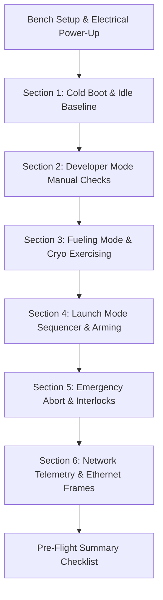
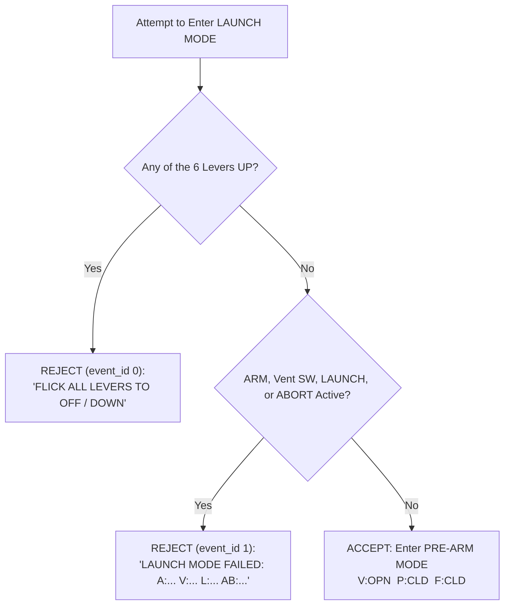
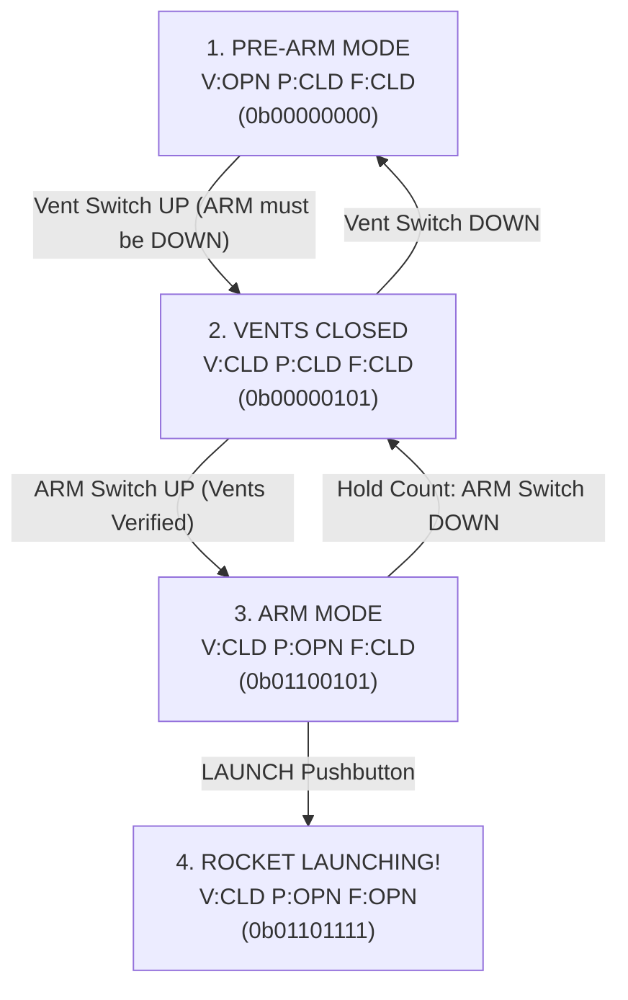
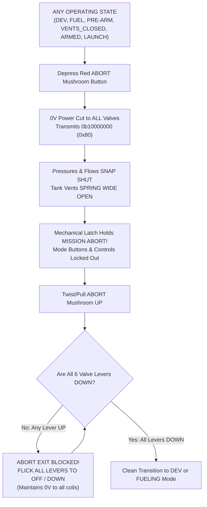

# Phoenix Ground Station: Hardware Verification & Validation Test Procedures

> [!IMPORTANT]
> **Bench & Pad Pre-Flight Validation Checklist**
> This document details the step-by-step hardware-in-the-loop (HIL) verification and validation procedures for the **Phoenix Ground Control Box**. Run through these checks on the bench prior to pad integration and static fire operations.

**Test Run Info:** Date: `_____________` | Operator: `_____________` | Firmware Git Commit: `_____________`

---

## Test Equipment & Prerequisites

* **Hardware Under Test:** Phoenix Ground Control Console (Arduino Mega 2560, W5500 Ethernet module, 20x4 I2C LCD).
* **Power Supply:** Regulated DC power supply set to **24.0 V** (or umbilical battery supply) + USB cable for Serial Monitor logging.
* **Test Monitoring Rig:**
  * Option A (Integrated): Umbilical Ethernet connection to Valve Driver Boards / test bench load box.
  * Option B (Standalone Bench): PC running Wireshark on Ethernet adapter or Arduino Serial Monitor at 115200 baud to inspect state byte transmission (`pkt[14]`).
* **Multimeter / Logic Probe:** For probing digital input pins and coil driver outputs if debugging physical switches.

> [!WARNING]
> **Electrical Command Verification vs. Pneumatic Validation:**
> These test procedures verify that the Ground Station correctly commands the **electronic state of the valve coils on the rocket's MOSFET driver board**. The Ground Station has no sensor feedback from physical valve poppets or seals. During pad integration and static fire, physical valve actuation must be validated by Fluids and Launch Operations using pneumatic pressure transducers, pad camera frost plume observations, and line pressure rise/decay rates.

---

## Summary of Test Categories

---

## Section 1: Cold Boot & Idle Baseline Checks

### 1.1 Cold Boot Sequence
* **Objective:** Verify that on power application, the Ground Station boots to an unpowered fail-safe state without energizing valve coils or glitching outputs.
* **Prerequisites:** All 6 toggle levers **DOWN**, Vent Switch **DOWN**, ARM Switch **DOWN**, ABORT Button **UP / UNLATCHED**.

| Step | Action | Expected Result | Pass / Fail |
| :---: | :--- | :--- | :---: |
| 1.1.1 | Apply 24V / USB power to the console. | LCD powers on, backlight illuminates, boots into idle mode (`NONE_MODE`). | [ ] PASS [ ] FAIL |
| 1.1.2 | Observe Serial Monitor output at 115200 baud. | Output displays `Setup`, `Ethernet Module Starting...`, `[W5500MacRaw]`, and MAC address. | [ ] PASS [ ] FAIL |
| 1.1.3 | Inspect transmitted state byte (`pkt[14]`). | Ground Station broadcasts `0b00000000` (`0x00`) every 200 ms. All valve coils remain at 0V. | [ ] PASS [ ] FAIL |

---

## Section 2: Developer Mode (`DEV MODE`) Verification

### 2.1 Mode Transition & 2-Second Switch Stabilization
* **Objective:** Ensure the 2-second stabilization delay executes properly and prevents switch bounce.

| Step | Action | Expected Result | Pass / Fail |
| :---: | :--- | :--- | :---: |
| 2.1.1 | With all levers DOWN, press the **`DEV MODE`** button. | LCD displays `SWITCHING STATE / WAIT...` for exactly 2 seconds. | [ ] PASS [ ] FAIL |
| 2.1.2 | Observe screen after 2-second delay. | LCD displays the 2-column manual valve matrix with all valves in unpowered state: `LNG_P:CLD   LNG-V:OPN` `LOX-P:CLD   LOX-V:OPN` `LNG-F:CLD   LOX-F:CLD` | [ ] PASS [ ] FAIL |

### 2.2 Individual Valve Toggle Verification
* **Objective:** Verify that each individual toggle lever commands its specific valve coil and reports the correct physical valve state (`OPN` vs `CLD`).

| Step | Valve Under Test | Action | Expected LCD Readout | Expected State Byte (`pkt[14]`) | Pass / Fail |
| :---: | :---: | :--- | :--- | :---: | :---: |
| 2.2.1 | `LNG-P` | Flip lever **UP** | `LNG_P:OPN` (Powered) | `0b01000000` (`0x40`) | [ ] PASS [ ] FAIL |
| 2.2.2 | `LNG-P` | Flip lever **DOWN** | `LNG_P:CLD` (Unpowered) | `0b00000000` (`0x00`) | [ ] PASS [ ] FAIL |
| 2.2.3 | `LOX-P` | Flip lever **UP** | `LOX-P:OPN` (Powered) | `0b00100000` (`0x20`) | [ ] PASS [ ] FAIL |
| 2.2.4 | `LOX-P` | Flip lever **DOWN** | `LOX-P:CLD` (Unpowered) | `0b00000000` (`0x00`) | [ ] PASS [ ] FAIL |
| 2.2.5 | `LNG-F` | Flip lever **UP** | `LNG-F:OPN` (Powered) | `0b00001000` (`0x08`) | [ ] PASS [ ] FAIL |
| 2.2.6 | `LNG-F` | Flip lever **DOWN** | `LNG-F:CLD` (Unpowered) | `0b00000000` (`0x00`) | [ ] PASS [ ] FAIL |
| 2.2.7 | `LOX-F` | Flip lever **UP** | `LOX-F:OPN` (Powered) | `0b00000010` (`0x02`) | [ ] PASS [ ] FAIL |
| 2.2.8 | `LOX-F` | Flip lever **DOWN** | `LOX-F:CLD` (Unpowered) | `0b00000000` (`0x00`) | [ ] PASS [ ] FAIL |
| 2.2.9 | `LNG-V` | Flip lever **UP** | `LNG-V:CLD` (Powered shut) | `0b00000100` (`0x04`) | [ ] PASS [ ] FAIL |
| 2.2.10 | `LNG-V` | Flip lever **DOWN** | `LNG-V:OPN` (Unpowered open) | `0b00000000` (`0x00`) | [ ] PASS [ ] FAIL |
| 2.2.11 | `LOX-V` | Flip lever **UP** | `LOX-V:CLD` (Powered shut) | `0b00000001` (`0x01`) | [ ] PASS [ ] FAIL |
| 2.2.12 | `LOX-V` | Flip lever **DOWN** | `LOX-V:OPN` (Unpowered open) | `0b00000000` (`0x00`) | [ ] PASS [ ] FAIL |

### 2.3 Multi-Valve Combination Test
| Step | Action | Expected LCD Readout | Expected State Byte | Pass / Fail |
| :---: | :--- | :--- | :---: | :---: |
| 2.3.1 | Flip **both vents (`LNG-V`, `LOX-V`) UP**. | `LNG-V:CLD`, `LOX-V:CLD` | `0b00000101` (`0x05`) | [ ] PASS [ ] FAIL |
| 2.3.2 | Flip **both pressures (`LNG-P`, `LOX-P`) UP** while vents are UP. | `LNG-V:CLD`, `LOX-V:CLD` `LNG_P:OPN`, `LOX-P:OPN` | `0b01100101` (`0x65`) | [ ] PASS [ ] FAIL |
| 2.3.3 | Return all 6 levers to **DOWN**. | All pressures & flows `CLD`, all vents `OPN`. | `0b00000000` (`0x00`) | [ ] PASS [ ] FAIL |

---

## Section 3: Fueling Mode (`FUELING MODE`) Verification

### 3.1 Flow & Pressurization Valve Lockout
* **Objective:** Verify that in `FUELING MODE`, main flow and pressurization valves are strictly locked closed in software and cannot be energized.

| Step | Action | Expected Result | Pass / Fail |
| :---: | :--- | :--- | :---: |
| 3.1.1 | With levers DOWN, press **`FUELING MODE`**. | 2s stabilization delay, then LCD displays `FUEL MODE` header table. | [ ] PASS [ ] FAIL |
| 3.1.2 | Flip `LNG-P` lever **UP**. | LCD displays `LNG_P:CLD`. Bit 6 remains `0` (`0b00000000`). Valve remains unpowered closed. | [ ] PASS [ ] FAIL |
| 3.1.3 | Flip `LOX-P` lever **UP**. | LCD displays `LOX-P:CLD`. Bit 5 remains `0`. Valve remains unpowered closed. | [ ] PASS [ ] FAIL |
| 3.1.4 | Flip `LNG-F` lever **UP**. | LCD displays `LNG-F:CLD`. Bit 3 remains `0`. Valve remains unpowered closed. | [ ] PASS [ ] FAIL |
| 3.1.5 | Flip `LOX-F` lever **UP**. | LCD displays `LOX-F:CLD`. Bit 1 remains `0`. Valve remains unpowered closed. | [ ] PASS [ ] FAIL |
| 3.1.6 | Return all 4 locked levers to **DOWN**. | Screen status unchanged. | [ ] PASS [ ] FAIL |

### 3.2 Cryogenic Vent Valve Control & Rapid Exercising Routine
* **Objective:** Validate independent vent toggle control in `FUELING MODE` and verify the pre-launch cryo ice-clearing cycling procedure.

| Step | Action | Expected Result | Pass / Fail |
| :---: | :--- | :--- | :---: |
| 3.2.1 | Flip `LNG-V` lever **UP**. | LCD updates `LNG-V:CLD`. State byte is `0b00000100` (`0x04`). Solenoid coil energizes shut. | [ ] PASS [ ] FAIL |
| 3.2.2 | Flip `LNG-V` lever **DOWN**. | LCD updates `LNG-V:OPN`. State byte is `0b00000000`. Valve unpowers (springs open). | [ ] PASS [ ] FAIL |
| 3.2.3 | Flip `LOX-V` lever **UP**. | LCD updates `LOX-V:CLD`. State byte is `0b00000001` (`0x01`). Solenoid coil energizes shut. | [ ] PASS [ ] FAIL |
| 3.2.4 | Flip `LOX-V` lever **DOWN**. | LCD updates `LOX-V:OPN`. State byte is `0b00000000`. Valve unpowers (springs open). | [ ] PASS [ ] FAIL |
| 3.2.5 | Cycle both vent levers UP and DOWN rapidly 5 times. | LCD updates synchronously without lag or display corruption. Both coils cycle cleanly. | [ ] PASS [ ] FAIL |
| 3.2.6 | Leave both vent levers **DOWN**. | LCD confirms `LNG-V:OPN` and `LOX-V:OPN`. Console ready for mode transition. | [ ] PASS [ ] FAIL |

---

## Section 4: Launch Mode Entry Interlocks

### 4.1 Valve Lever Interlock Check (Event ID 0)
* **Objective:** Ensure the console rejects Launch Mode entry if any individual valve lever is left UP / ON.

| Test # | Configuration Prior to Pressing `LAUNCH MODE` | Expected Console Response | Pass / Fail |
| :---: | :--- | :--- | :---: |
| 4.1.1 | `LNG-P` lever **UP**, all others DOWN | LCD flashes `LAUNCH MODE FAILED / FLICK ALL LEVERS / TO OFF / DOWN` for 2s. Reverts to source mode. | [ ] PASS [ ] FAIL |
| 4.1.2 | `LOX-P` lever **UP**, all others DOWN | Rejected with `FLICK ALL LEVERS TO OFF / DOWN`. Reverts to source mode. | [ ] PASS [ ] FAIL |
| 4.1.3 | `LNG-F` lever **UP**, all others DOWN | Rejected with `FLICK ALL LEVERS TO OFF / DOWN`. Reverts to source mode. | [ ] PASS [ ] FAIL |
| 4.1.4 | `LOX-F` lever **UP**, all others DOWN | Rejected with `FLICK ALL LEVERS TO OFF / DOWN`. Reverts to source mode. | [ ] PASS [ ] FAIL |
| 4.1.5 | `LNG-V` lever **UP**, all others DOWN | Rejected with `FLICK ALL LEVERS TO OFF / DOWN`. Reverts to source mode. | [ ] PASS [ ] FAIL |
| 4.1.6 | `LOX-V` lever **UP**, all others DOWN | Rejected with `FLICK ALL LEVERS TO OFF / DOWN`. Reverts to source mode. | [ ] PASS [ ] FAIL |

### 4.2 Control Switch / Button Interlock Check (Event ID 1)
* **Objective:** Ensure the console rejects Launch Mode entry if arming controls or pushbuttons are active.

| Test # | Configuration Prior to Pressing `LAUNCH MODE` | Expected Console Response | Pass / Fail |
| :---: | :--- | :--- | :---: |
| 4.2.1 | Covered **ARM** switch **UP** | LCD displays `LAUNCH MODE FAILED / A:1 V:0 L:0 AB:0` for 1.5s. Reverts to source mode. | [ ] PASS [ ] FAIL |
| 4.2.2 | **Vent Actuation Switch UP** | LCD displays `LAUNCH MODE FAILED / A:0 V:1 L:0 AB:0` for 1.5s. Reverts to source mode. | [ ] PASS [ ] FAIL |
| 4.2.3 | **LAUNCH** pushbutton held down | LCD displays `LAUNCH MODE FAILED / A:0 V:0 L:1 AB:0` for 1.5s. Reverts to source mode. | [ ] PASS [ ] FAIL |
| 4.2.4 | **ABORT** mushroom button latched down | Mode press ignored entirely (E-stop lockout). Console does not switch modes. | [ ] PASS [ ] FAIL |
| 4.2.5 | All levers and switches **DOWN**, ABORT unlatched | 2s stabilization delay, then enters `PRE-ARM MODE` (`V:OPN P:CLD F:CLD`). Transmits `0x00`. | [ ] PASS [ ] FAIL |

---

## Section 5: Launch Sequencer Decoupled Arming & Flight Logic

### 5.1 Nominal Countdown & Arming Sequence (The "Happy Trail")

| Step | Action | Expected LCD Screen | Expected State Byte (`pkt[14]`) | Physical Valve Status | Pass / Fail |
| :---: | :--- | :--- | :---: | :--- | :---: |
| 5.1.1 | From clean baseline, enter `LAUNCH MODE`. | `LAUNCH SEQUENCE` `  PRE ARM MODE  ` `V:OPN P:CLD F:CLD` | `0b00000000` (`0x00`) | Vents: OPEN Press: CLOSED Flows: CLOSED | [ ] PASS [ ] FAIL |
| 5.1.2 | Flip **Vent Actuation Switch UP**. | `LAUNCH SEQUENCE` `  VENTS CLOSED  ` `V:CLD P:CLD F:CLD` | `0b00000101` (`0x05`) | Vents: **CLOSED** (Powered) Press: CLOSED Flows: CLOSED | [ ] PASS [ ] FAIL |
| 5.1.3 | Observe pad cameras / plume (Simulate visual check). | Both vent lines confirmed seated shut. | N/A | Vents held shut. | [ ] PASS [ ] FAIL |
| 5.1.4 | Flip covered **ARM Switch UP**. | `LAUNCH SEQUENCE` `    ARM MODE    ` `V:CLD P:OPN F:CLD` | `0b01100101` (`0x65`) | Vents: **CLOSED** (Powered) Press: **OPEN** (Powered) Flows: CLOSED | [ ] PASS [ ] FAIL |
| 5.1.5 | Press momentary **`LAUNCH`** button. | `LAUNCH SEQUENCE` `ROCKET LAUNCHING! ` `V:CLD P:OPN F:OPN` `Ad Astra Per Aspera!` | `0b01101111` (`0x6F`) | Vents: **CLOSED** (Powered) Press: **OPEN** (Powered) Flows: **OPEN** (Powered) | [ ] PASS [ ] FAIL |

### 5.2 Arming Interlock & Misoperation Tests
* **Objective:** Verify that high-pressure $\text{GN}_2$ valves can **never** be commanded open while vents are open, and disarming works reliably.

| Test # | Starting State | Operator Action | Expected Response & Safety Guarantee | Pass / Fail |
| :---: | :--- | :--- | :--- | :---: |
| 5.2.1 | `PRE ARM MODE` (Vent Switch DOWN) | Flip **ARM Switch UP** | **ARM switch is ignored!** Console remains in `PRE ARM MODE` (`V:OPN P:CLD F:CLD`). State byte remains `0x00`. Pressure valves stay closed. | [ ] PASS [ ] FAIL |
| 5.2.2 | `VENTS CLOSED` (Vent Switch UP) | Flip **Vent Switch DOWN** | Console immediately reverts to `PRE ARM MODE` (`V:OPN P:CLD F:CLD`). Vents unpower and spring open (`0x00`). | [ ] PASS [ ] FAIL |
| 5.2.3 | `ARM MODE` (Vent UP, ARM UP) | Flip **ARM Switch DOWN** (Hold count) | Pressure valves instantly close (`0V`). Console returns to `VENTS CLOSED` (`V:CLD P:CLD F:CLD`, `0x05`), holding tank pressure without gas addition. | [ ] PASS [ ] FAIL |
| 5.2.4 | `VENTS CLOSED` (From 5.2.3 hold) | Flip **Vent Switch DOWN** (Depressurize) | Vents instantly unpower and spring open. Console returns to `PRE ARM MODE` (`V:OPN P:CLD F:CLD`, `0x00`), safely venting the tanks. | [ ] PASS [ ] FAIL |
| 5.2.5 | `ARM MODE` (Vent UP, ARM UP) | Flip **Vent Switch DOWN** while ARM is UP | **Vent Switch Ignored:** Console remains firmly in `ARM MODE` (`0b01100101`, `0x65`). Vents stay closed; GN2 pressure valves stay open. LCD continues to show `ARM MODE`. | [ ] PASS [ ] FAIL |
| 5.2.6 | `ARM MODE` (From 5.2.5 with Vent Switch DOWN) | Flip guarded **ARM Switch DOWN** | **Pneumatic Sequencing Protection:** Console transitions to `VENTS CLOSED` (`0x05`). Pressures snap shut (`0V`). Vents **remain powered closed** to prevent simultaneous depower. Console stays in `VENTS CLOSED`. Direct drop to `PRE-ARM` is blocked! | [ ] PASS [ ] FAIL |
| 5.2.6a | Console in `VENTS CLOSED` from 5.2.6 | Leave Vent Switch DOWN or toggle levers | Vents remain energized shut (`0x05`). State machine refuses to enter `PRE-ARM` directly from `ARM MODE`. | [ ] PASS [ ] FAIL |
| 5.2.6b | Console in `VENTS CLOSED` from 5.2.6 | Flick Vent Switch **UP**, then **DOWN** | Console transitions cleanly to `PRE-ARM MODE` (`0x00`). Vents unpower and spring open to atmosphere. Pressures and vents were cleanly separated. | [ ] PASS [ ] FAIL |
| 5.2.7 | `PRE ARM MODE` (With ARM Switch UP) | Flip **Vent Switch UP** while ARM is UP | **Pre-Arm Lockout:** Console refuses to close vents and stays in `PRE ARM MODE` (`0x00`). Both switches must be returned to DOWN before initiating countdown. | [ ] PASS [ ] FAIL |
| 5.2.8 | `LAUNCH MODE` (Any stage) | Toggle any of the 6 valve levers UP/DOWN | **Software Lockout:** Valve levers produce zero response on the LCD or Ethernet state byte. | [ ] PASS [ ] FAIL |

---

## Section 6: Emergency Abort & Recovery Interlocks

### 6.1 Abort Trigger Across All Operating States
* **Objective:** Verify that depressing the red ABORT button instantly drops coil power to 0V and displays the abort screen regardless of current mode or stage.

| Test # | Active State Prior to Abort | Action | Expected Response | Pass / Fail |
| :---: | :--- | :--- | :--- | :---: |
| 6.1.1 | `DEV MODE` (Valves energized) | Depress **ABORT** button | Mode instantly aborts; all coils drop to 0V. State byte transmits `0x80`. | [ ] PASS [ ] FAIL |
| 6.1.2 | `FUELING MODE` (Vents energized) | Depress **ABORT** button | Vent coils drop to 0V, vents spring open. State byte transmits `0x80`. | [ ] PASS [ ] FAIL |
| 6.1.3 | `PRE ARM MODE` | Depress **ABORT** button | LCD displays `MISSION ABORT! / ALL VENTS OPENED!`. All outputs 0V. | [ ] PASS [ ] FAIL |
| 6.1.4 | `VENTS CLOSED` | Depress **ABORT** button | Vent coils de-energize immediately; vents spring wide open. LCD updates to `MISSION ABORT!`. | [ ] PASS [ ] FAIL |
| 6.1.5 | `ARM MODE` | Depress **ABORT** button | Pressure valves snap shut; vents spring wide open. LCD updates to `MISSION ABORT!`. | [ ] PASS [ ] FAIL |
| 6.1.6 | `ROCKET LAUNCHING!` | Depress **ABORT** button | Main flows snap shut; pressure valves snap shut; vents spring open. LCD updates to `MISSION ABORT!`. | [ ] PASS [ ] FAIL |

### 6.2 Mechanical E-Stop Latch Lockout
| Step | Action | Expected Result | Pass / Fail |
| :---: | :--- | :--- | :---: |
| 6.2.1 | With ABORT mechanically latched down, press **`DEV MODE`**. | Button is completely ignored. Console remains locked in `MISSION ABORT!`. | [ ] PASS [ ] FAIL |
| 6.2.2 | With ABORT mechanically latched down, press **`FUELING MODE`**. | Button is completely ignored. Console remains locked in `MISSION ABORT!`. | [ ] PASS [ ] FAIL |
| 6.2.3 | With ABORT mechanically latched down, press **`LAUNCH MODE`**. | Button is completely ignored. Console remains locked in `MISSION ABORT!`. | [ ] PASS [ ] FAIL |
| 6.2.4 | With ABORT mechanically latched down, flip **ARM** switch or press **LAUNCH** button. | Zero response. Console remains locked in `MISSION ABORT!`. | [ ] PASS [ ] FAIL |

### 6.3 Abort Exit Interlock (The 5 Core Hardware Tests)
* **Objective:** Guarantee that the console refuses to exit an emergency abort if any valve toggle lever is flipped UP / ON, preventing uncommanded valve energization during abort safing.

| Test # | Initial State | Operator Action | Expected Console Response | Pass / Fail |
| :---: | :--- | :--- | :--- | :---: |
| **Test 1** *(Clean Exit)* | `MISSION ABORT!` latched. All levers DOWN. | 1. Unlatch ABORT button (pull UP). 2. Press **`DEV MODE`**. | Abort clears cleanly. Console displays `SWITCHING STATE` for 2s, then enters `DEV MODE` with all valves unpowered (`CLD` / `OPN`). | [ ] PASS [ ] FAIL |
| **Test 2** *(Single Lever Block)* | `MISSION ABORT!` latched. All levers DOWN. | 1. Flip `LNG-P` lever **UP**. 2. Unlatch ABORT button. 3. Press **`DEV MODE`**. | **TRANSITION BLOCKED!** LCD flashes `ABORT EXIT BLOCKED / FLICK ALL LEVERS / TO OFF / DOWN` for 2s, then restores `MISSION ABORT!`. Valve outputs stay locked at 0V. | [ ] PASS [ ] FAIL |
| **Test 3** *(Multi-Lever Block)* | `MISSION ABORT!` latched. | 1. Flip `LOX-P` and `LNG-F` levers **UP**. 2. Unlatch ABORT button. 3. Press **`DEV MODE`**. | **TRANSITION BLOCKED!** LCD displays `ABORT EXIT BLOCKED` warning and restores `MISSION ABORT!`. Zero power applied to coils. | [ ] PASS [ ] FAIL |
| **Test 4** *(Exit into Fueling Mode Block)* | `MISSION ABORT!` latched. | 1. Flip `LOX-V` lever **UP**. 2. Unlatch ABORT button. 3. Press **`FUELING MODE`**. | **TRANSITION BLOCKED!** LCD displays `ABORT EXIT BLOCKED` warning and restores `MISSION ABORT!`. Zero power applied to coils. | [ ] PASS [ ] FAIL |
| **Test 5** *(Correction & Recovery)* | Console blocked in `MISSION ABORT!` from Test 4. | 1. Physically flip all levers back to **DOWN / OFF**. 2. Press **`DEV MODE`** (or `FUELING MODE`). | Console accepts transition, runs 2s stabilization delay, and enters selected mode safely. | [ ] PASS [ ] FAIL |

### 6.4 Post-Launch Safing & Recovery to DEV Mode (Protocol A Verification)
* **Objective:** Verify that following an active engine burn (`LAUNCH` mode), mode buttons are locked out until safed via the ABORT button, and cleanly recover to DEV mode.

| Step | Current Operating State | Action | Expected Result | Pass / Fail |
| :---: | :--- | :--- | :--- | :---: |
| 6.4.1 | `ROCKET LAUNCHING!` (`0x6F`) | Press **`DEV MODE`** or **`FUELING MODE`**. | **Mode buttons locked out!** Console remains firmly in `LAUNCH` mode. Main flows remain active. | [ ] PASS [ ] FAIL |
| 6.4.2 | `ROCKET LAUNCHING!` (`0x6F`) | Depress the red **`ABORT`** mushroom button (MECO). | Flow and pressure valves snap shut (`0V`); vents spring wide open. LCD updates to `MISSION ABORT! ALL VENTS OPENED!`. | [ ] PASS [ ] FAIL |
| 6.4.3 | `MISSION ABORT!` | Lower **ARM Switch**, lower **Vent Switch**, verify all 6 levers are **DOWN**. | Switch baseline established for safe recovery. | [ ] PASS [ ] FAIL |
| 6.4.4 | `MISSION ABORT!` | Unlatch **ABORT** button (pull/twist UP). | Abort latch cleared. LCD continues to show `MISSION ABORT!`. | [ ] PASS [ ] FAIL |
| 6.4.5 | Unlatched Abort | Press **`DEV MODE`**. | Console runs 2s stabilization delay (`SWITCHING STATE / WAIT...`), then cleanly enters `DEV MODE` with all valves unpowered. | [ ] PASS [ ] FAIL |

---

## Section 7: Mode Switching Lockouts & Edge Cases

### 7.1 In-Flight Mode Lockout
* **Objective:** Ensure mode buttons cannot accidentally dump tank pressure or terminate countdown while armed or launched.

| Step | Current Operating State | Action | Expected Result | Pass / Fail |
| :---: | :--- | :--- | :--- | :---: |
| 7.1.1 | `VENTS CLOSED` | Press **`DEV MODE`** or **`FUELING MODE`**. | Mode buttons are **completely ignored**. Console remains in `VENTS CLOSED`. | [ ] PASS [ ] FAIL |
| 7.1.2 | `ARM MODE` | Press **`DEV MODE`** or **`FUELING MODE`**. | Mode buttons are **completely ignored**. High-pressure $\text{GN}_2$ remains flowing. | [ ] PASS [ ] FAIL |
| 7.1.3 | `ROCKET LAUNCHING!` | Press **`DEV MODE`** or **`FUELING MODE`**. | Mode buttons are **completely ignored**. Main flows remain active. | [ ] PASS [ ] FAIL |

### 7.2 Simultaneous Mode Button Rejection
| Step | Action | Expected Result | Pass / Fail |
| :---: | :--- | :--- | :---: |
| 7.2.1 | Press **`DEV MODE`** and **`FUELING MODE`** simultaneously. | Multiple input detected; command is rejected. Console maintains previous mode. | [ ] PASS [ ] FAIL |
| 7.2.2 | Press **`FUELING MODE`** and **`LAUNCH MODE`** simultaneously. | Multiple input detected; command is rejected. Console maintains previous mode. | [ ] PASS [ ] FAIL |
| 7.2.3 | Press all three mode buttons simultaneously. | Multiple input detected; command is rejected. Console maintains previous mode. | [ ] PASS [ ] FAIL |

### 7.3 Ground Station Power-Cycle / Brownout Simulation
| Step | Action | Expected Result | Pass / Fail |
| :---: | :--- | :--- | :---: |
| 7.3.1 | In `DEV MODE`, flip `LNG-P` UP (valve open). Cut console power. | Power drops to 0V immediately. Solenoid closes. | [ ] PASS [ ] FAIL |
| 7.3.2 | Restore power while `LNG-P` lever remains UP. | Console reboots into `NONE_MODE` (idle). Output transmits `0x00`. **Valve coil is NOT energized.** Levers are not scanned until a mode is pressed. | [ ] PASS [ ] FAIL |
| 7.3.3 | Press `LAUNCH MODE`. | Console detects `LNG-P` is UP and **rejects entry** with `FLICK ALL LEVERS TO OFF / DOWN`. | [ ] PASS [ ] FAIL |

---

## Section 8: Network Telemetry & Ethernet Frame Validation

### 8.1 Ethernet Frame Header & Cadence Inspection
* **Setup:** Connect PC Ethernet port to Ground Station W5500 port via Cat5e cable. Run Wireshark with filter `eth.type == 0x63e4 || eth.type == 0x8886`.

| Step | Item | Expected Value | Pass / Fail |
| :---: | :--- | :--- | :---: |
| 8.1.1 | Packet Transmission Rate | Exactly 1 packet burst every 200 ms ($\pm 10\text{ ms}$). | [ ] PASS [ ] FAIL |
| 8.1.2 | Relief Valve Packet Destination MAC | `02:52:56:00:00:02` (`MAC_RELIEF_VALVE`) | [ ] PASS [ ] FAIL |
| 8.1.3 | Flow Valve Packet Destination MAC | `02:46:4C:00:00:03` (`MAC_FLOW_VALVE`) | [ ] PASS [ ] FAIL |
| 8.1.4 | Ground Station Source MAC | `02:47:53:00:00:01` (`MAC_GROUND_STATION`) | [ ] PASS [ ] FAIL |
| 8.1.5 | EtherType Byte | `0x63 0xe4` | [ ] PASS [ ] FAIL |

### 8.2 State Word (`pkt[14]`) Binary Encoding Table
Verify in Wireshark payload (byte offset 14) or serial logging:

| Operating State | Binary Bit Pattern (`Bit 7 ... Bit 0`) | Hex Value | Valve Status Representation | Verified |
| :--- | :---: | :---: | :--- | :---: |
| `PRE_ARM` (Safe Standby) | `0b00000000` | `0x00` | All coils 0V; Fail-Open vents spring open. | [ ] PASS |
| `VENTS_CLOSED` | `0b00000101` | `0x05` | `LNG-V` & `LOX-V` coils energized shut. | [ ] PASS |
| `ARMED` | `0b01100101` | `0x65` | Vents energized shut; `LNG-P` & `LOX-P` open. | [ ] PASS |
| `LAUNCH` | `0b01101111` | `0x6F` | Vents shut; Pressures open; `LNG-F` & `LOX-F` open. | [ ] PASS |
| `ABORT` | `0b10000000` | `0x80` | Bit 7 non-valve flag; all coils 0V; vents wide open. | [ ] PASS |

---

## Pre-Flight Status Checklist

Quick pre-flight verification before hooking up the umbilical cable on the pad:

- [ ] **Cold Boot & Baseline:** Console powers on cleanly into idle with 0V transmitted across all coils.
- [ ] **DEV Mode Manual Check:** All 6 valve toggles actuate their respective coils and report correct `OPN`/`CLD` states.
- [ ] **Fueling Mode Lockout:** Main flows and pressures locked out; vents exercised 5x without lag or display glitches.
- [ ] **Launch Mode Entry Interlocks:** Mode entry blocked if any lever, ARM switch, or Vent switch is UP.
- [ ] **Decoupled Arming:** Vents seal first; pressure cannot open until vents are closed; disarm returns safely.
- [ ] **Emergency Abort:** Instantly cuts power across all states; Abort Exit Interlock blocks entry if levers are UP.
- [ ] **Ready for Pad Integration / Static Fire**
